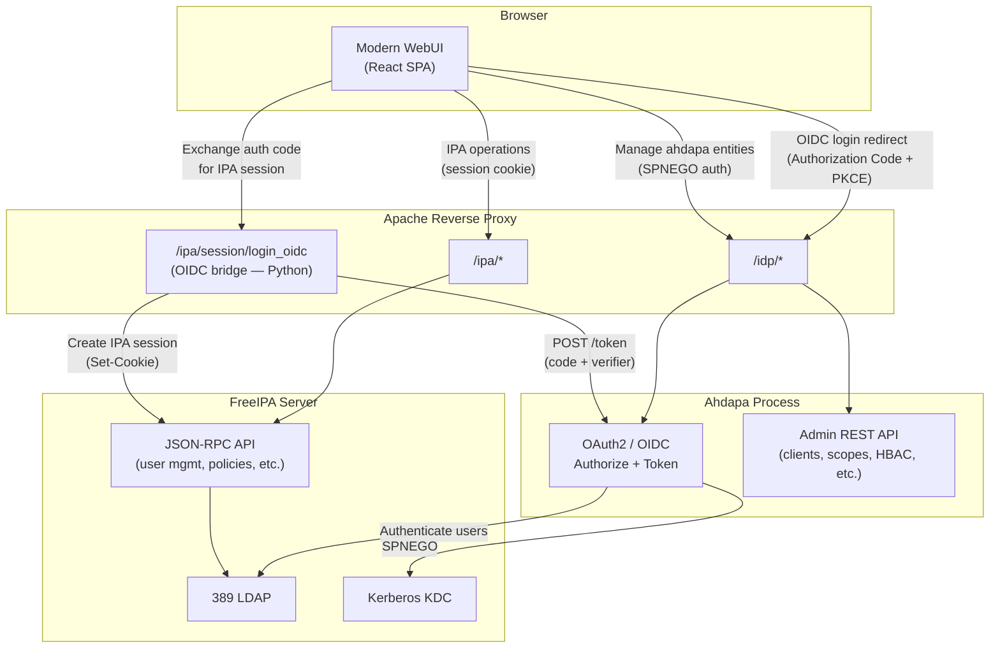
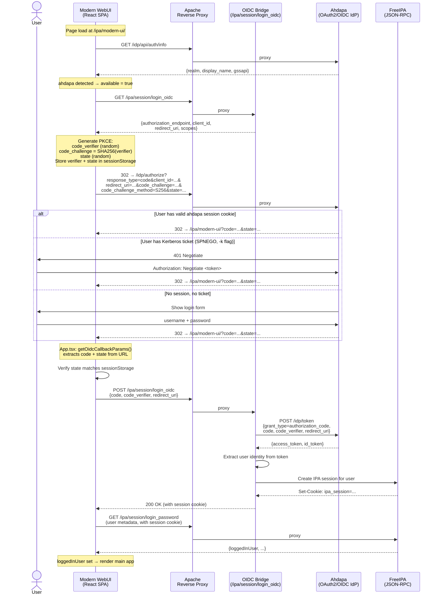
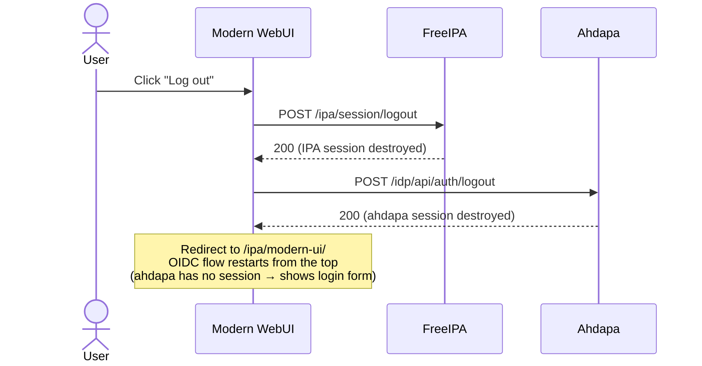

# Authentication via ahdapa (OAuth2/OIDC)

## Overview

[Ahdapa](https://forge.fedoraproject.org/freeipa/ahdapa) is a stateless OAuth 2.0 / OpenID Connect Identity Provider built for FreeIPA. It authenticates users against the same LDAP directory and Kerberos realm that FreeIPA uses, but through standard OAuth2/OIDC protocols. It supports SPNEGO (Kerberos-based browser SSO), username/password login, and federation with external identity providers.

The modern webui integrates ahdapa in two ways:

1. **OIDC login flow** — an alternative login path that delegates authentication to ahdapa via Authorization Code + PKCE, then establishes a standard IPA session.
2. **Management pages** — admin UI for managing ahdapa's own entities (OAuth2 clients, scopes, federation policies, SAML providers, etc.).

Both are optional. On startup, the webui probes `GET /idp/api/auth/info`. If ahdapa responds, the login flow and management pages are enabled. If ahdapa is not deployed, the webui works unchanged with Kerberos and password login.

## Architecture

In a co-deployed setup, ahdapa runs as a systemd service on the same host as FreeIPA. Apache reverse-proxies requests under `/idp/` to the ahdapa process. The OIDC bridge (`oidc-bridge.py`) adds a `/ipa/session/login_oidc` endpoint that bridges the OAuth2 world and FreeIPA's native session mechanism.

## OIDC login flow

Instead of authenticating directly against FreeIPA (via `login_password` or Kerberos), the webui delegates authentication to ahdapa through a standard OAuth2 flow. The webui redirects the browser to ahdapa's authorize endpoint, where the user authenticates — either via ahdapa's login form, SPNEGO, or an existing session cookie. After successful authentication, ahdapa redirects back to the webui with an authorization code, which the webui exchanges for an IPA session through the OIDC bridge.

The flow uses **Authorization Code + PKCE** (Proof Key for Code Exchange), which is the recommended OAuth2 grant for single-page applications:

### The OIDC bridge

The OIDC bridge (`oidc-bridge.py`) bridges the gap between the OAuth2 world and FreeIPA's native session mechanism. FreeIPA's httpd doesn't natively speak OAuth2, so the bridge adds a `/ipa/session/login_oidc` endpoint that:

- Accepts the authorization code and PKCE verifier from the browser
- Exchanges them with ahdapa's token endpoint for an access token
- Uses the access token to identify the user
- Creates a standard FreeIPA session (the same cookies that `login_password` would set)

After this, the webui operates normally — all IPA API calls use the standard session cookie. Ahdapa is only involved during authentication.

### Static client registration

The webui is registered as an OAuth2 client in ahdapa via a `clients.toml` file (created by the Ansible playbook). This avoids the need for dynamic registration and gives the client a predictable `client_id`. The client is configured as a public client (`token_endpoint_auth_method = "none"`) with PKCE, which is the standard for browser-based applications.

## Login page behavior

The login page (`LoginMainPage.tsx`) has priority-based auto-login logic:

1. If ahdapa is available → auto-redirect to OIDC flow (no user interaction needed)
2. If ahdapa is not available → try Kerberos (SPNEGO) auto-login
3. If both fail → show the username/password form

After explicit logout, auto-redirect is suppressed (via `isKerberosDisabled` in sessionStorage) so the user sees the login form with the "Login using Single Sign-On" button, rather than being immediately logged back in by SPNEGO or an existing ahdapa session cookie.

## Logout flow

When the user logs out, both the IPA session and the ahdapa session are destroyed. The browser is then redirected to `/ipa/modern-ui/`, which restarts the OIDC flow from the top. Since the ahdapa session no longer exists, ahdapa shows its login form.

## Management pages

The management UI adds admin pages for ahdapa's own entities: OAuth2 clients, scopes, federation policies, federated accounts, IPA identity providers, SAML2 IdPs/SPs, SPIFFE trust domains, HBAC rules, signing keys, cluster nodes, and audit log.

These are standard CRUD pages that call ahdapa's admin REST API through RTK Query. All service modules inject their endpoints into a shared `ahdapaApi` instance (`rpcAhdapa.ts`).

The RTK Query base query includes transparent SPNEGO negotiation for the management API. If any ahdapa admin API call returns 401 (no session), the base query automatically calls `GET /idp/api/auth/negotiate` — an endpoint that triggers the browser's Kerberos Negotiate handshake to establish an ahdapa session — and then retries the original request. This means the management pages authenticate silently via the user's Kerberos ticket, without requiring explicit login to ahdapa's admin API.

The sidebar section and routes are conditionally rendered: when ahdapa is not deployed, the management pages are hidden and the webui works unchanged.

## React StrictMode considerations

Because the webui uses React StrictMode (which double-invokes effects and state initializers in development), the OIDC flow has guards against race conditions:

- A `useRef` guard (`oidcHandled`) prevents the authorization code exchange from running twice — the second invocation would find no PKCE verifier in sessionStorage (already consumed by the first) and fail with "invalid-state"
- A module-level flag (`oidcLoginInFlight`) prevents the OIDC redirect from being initiated twice — without it, two concurrent calls would race and the losing call's PKCE values would overwrite the winning call's in sessionStorage
- The OIDC error is read via `useState` (not `useMemo`) because React keeps the first result for `useState` but the second for `useMemo` — a side-effecting read (read + delete from sessionStorage) would lose the value with `useMemo`, causing the auto-redirect to fire again and creating an infinite loop

## Key files

| File | Purpose |
|------|---------|
| `src/utils/oidcUtils.ts` | PKCE generation, OIDC initiation and completion |
| `src/App.tsx` | OIDC callback handler with StrictMode-safe ref guard |
| `src/pages/Login/LoginMainPage.tsx` | Auto-redirect logic with error recovery |
| `src/AppLayout.tsx` | Logout handler (destroys both IPA and ahdapa sessions) |
| `src/services/rpcAhdapa.ts` | RTK Query base API with SPNEGO negotiation |
| `src/store/Ahdapa/ahdapa-slice.ts` | Redux state for ahdapa availability |
| `developer/oidc-bridge.py` | Exchanges authorization codes for IPA sessions |
| `developer/deploy-ahdapa.yml` | Ansible playbook for ahdapa deployment |

## Known limitations

- **`admin` cannot use SPNEGO through ahdapa**: the `admin` user has ~246 recursive group memberships (from IPA roles and privileges). When ahdapa serializes the Kerberos credential cache into the session cookie (`krb5:ccache` scope), the cookie exceeds browser size limits. The dev environment uses `devadmin` instead, which gets equivalent write access via a direct LDAP ACI with no `memberOf` overhead. Username/password login works for both users.
- **Ahdapa session persists across browser launches**: the ahdapa session cookie lives in the Firefox profile, so closing and reopening the browser (even without `-k`) auto-logs in if a previous session is still valid. Use `open-browser.sh -r` to clear the profile, or log out via the webui before closing.
- **Chrome does not support SPNEGO in the dev environment**: the `open-browser.sh` script only configures SPNEGO prefs for Firefox. Chrome would require `--auth-server-allowlist` flags.
- **SPNEGO hostname is hardcoded**: the Firefox `network.negotiate-auth.trusted-uris` pref is set to `https://webui.ipa.test`. Non-default hostnames would require manual adjustment in `developer/firefox_config.sh`.
